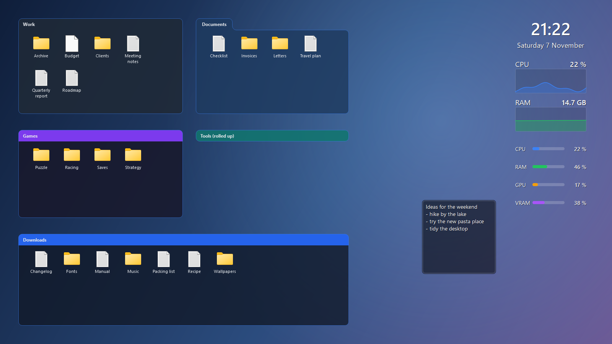
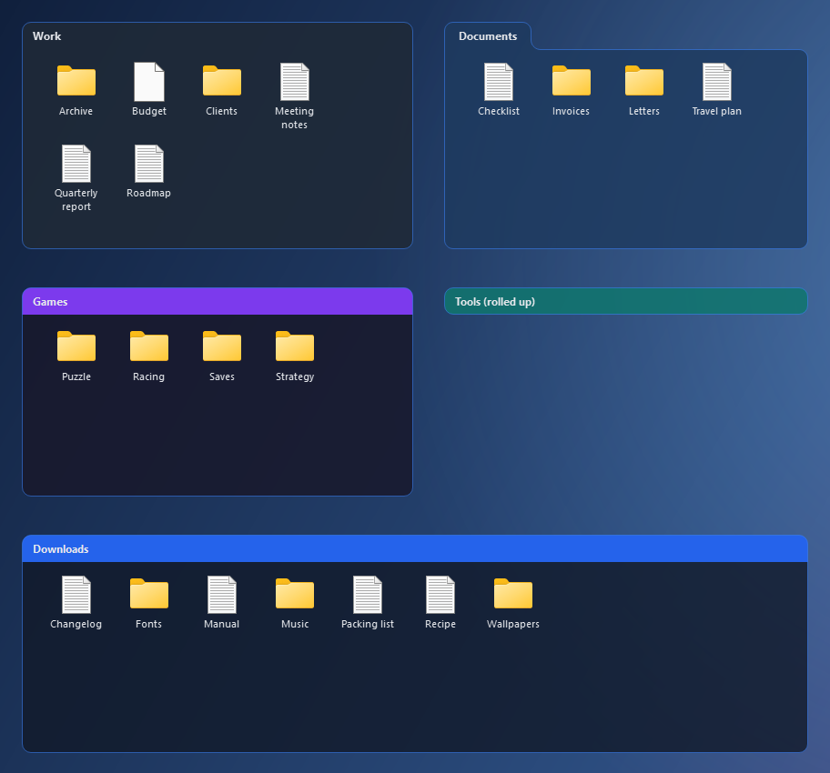
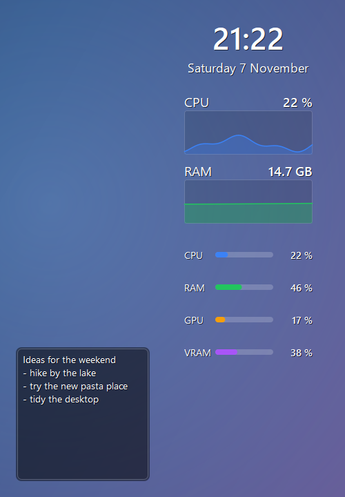
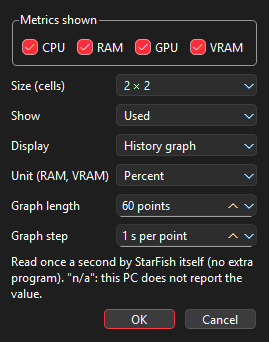

# StarFish

StarFish is a free, open-source desktop organizer for Windows 10/11. It groups your desktop
icons into translucent **zones** ("fences") that you can sort, style and roll up. It was inspired
by desktop organizers such as Stardock Fences, but it is an independent project.



| Zones: tabs, colored title bars, roll-up | Desktop widgets: clock, CPU/RAM graphs, system group, note | Widget settings |
|---|---|---|
| [](docs/images/zones.png) | [](docs/images/widgets.png) | [](docs/images/widget-settings.png) |

<sub>Screenshots are rendered from a synthetic demo (`starfish --readme-probe`): dummy files, generated wallpaper, simulated readings.</sub>

## Features

- **Zones** on the desktop: drag icons in, sort, rename, icon grid, multiple monitors; **lock** a zone so it cannot be moved, resized or changed by accident.
- **Roll-up**: double-click a zone's title bar to roll it up or unroll it, at the speed you choose; optionally unroll on hover.
- **Appearance**: transparency, acrylic blur, colors, borders, a title bar on any side (or none at all), and reusable **templates**.
- **Widgets** in zones or directly on the desktop (a zone's widgets move between zones; desktop widgets stay on the desktop and can sit behind zones), lockable, Image widgets on the desktop sized freely: clock, notes, image, CPU / RAM / GPU / VRAM (number, bar or history graph) and a compact system group, each with its own settings window.
- Filed shortcuts are **kept and restorable**. Desktop icons always come back if StarFish stops.
- **Leaves Explorer alone**: no code injected into `explorer.exe`, no patching. StarFish draws its own
  desktop layer and only hides Explorer's icon view while it runs; your icons come back as soon as it stops.
- Optional start with Windows, splash screen, English and French UI (switch language without restarting).

## Status

**Alpha, v0.1.3.** The author uses it daily, but expect bugs. Back up `%APPDATA%\StarFish`
before trying a new version.

## Installation

1. Download `StarFish-<version>-setup.exe` from [Releases](https://github.com/Narkotine/starfish/releases).
2. Run it. It installs **per user, with no admin rights**, into `%LOCALAPPDATA%\Programs\StarFish`.
3. Releases are not code-signed yet, so Windows SmartScreen may say "Windows protected your PC".
   Click **More info > Run anyway** (in French: *Informations complémentaires > Exécuter quand même*).
   Each setup's SHA-256 checksum is published next to it (`.sha256`).

### Your data

- Zones, settings, kept shortcuts and automatic backups: `%APPDATA%\StarFish` (backups in `backups\`).
- Logs and caches: `%LOCALAPPDATA%\StarFish`. Settings: `HKCU\Software\StarFish`.
- Updates never touch this data. **Uninstalling keeps it by default** (an explicit prompt lets you
  delete it), and gives the desktop its native icons back.

## Building from source

Requirements: Windows 10/11, **Qt 6.8**, **CMake ≥ 3.24**, **Ninja**, and either **MinGW 13**
(shipped with the Qt installer) or **MSVC 2022**.

```powershell
cmake -S . -B build -G Ninja -DCMAKE_BUILD_TYPE=Release -DCMAKE_PREFIX_PATH=C:/Qt/6.8.3/mingw_64
cmake --build build
ctest --test-dir build
build\starfish.exe
```

Installer (needs Inno Setup 6): `pwsh tools/build_installer.ps1` or
`cmake --build build --target installer`. Details (in French): [`docs/mises-a-jour.md`](docs/mises-a-jour.md).

## Documentation

Developer documentation (in French): [`docs/reprise.md`](docs/reprise.md) is the entry point.

## License

[MIT](LICENSE) © 2026 Narkotine.
